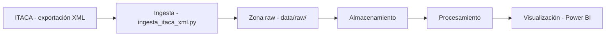

# Proyecto 1 · Analítica académica ITACA (origen XML)

## Descripción y objetivo

Construir un dashboard de análisis académico en Power BI a partir de datos reales de la plataforma ITACA de la Conselleria de Educación, extraídos como ficheros XML.

## Arquitectura

## Fuentes de datos

**Origen:** exportación XML de ITACA (CIPFP Mislata, código 46019660), un directorio por curso
escolar en `data/exportaciones/Analisis_Academico/<AAAA-AA>/` (2021-22 a 2025-26).

**Mecanismo de acceso:** ficheros XML exportados manualmente desde ITACA. Cada fichero tiene un
nodo raíz `<centro curso="AAAA">` (de donde sale el `Anyo`), un nodo contenedor y un elemento por
registro con los datos como atributos. No requiere credenciales.

| Tabla | Fichero | Campos disponibles |
|---|---|---|
| Alumnos | `alumnos.xml` | NIA, curso, grupo, turno, ensenanza, linea, modalidad, repite, estado_matricula |
| Cursos | `cursos.xml` | codigo, nombre_cas, nombre_val, abreviatura, padre |
| Calificaciones | `calificaciones.xml` | alumno (NIA), curso, contenido (módulo), nota_numerica, evaluacion, tipo_nota |
| Contenidos | `contenidos.xml` | codigo, nombre_cas, nombre_val, curso |

**Frecuencia de actualización esperada:** una exportación completa por curso escolar, con
reexportaciones al cierre de cada evaluación para actualizar las calificaciones.

## Bitácora de prácticas

### Bloque 1

#### P1 — Ingesta de datos ITACA (XML)

**Proceso seguido**

1. Lectura de los XML de cada curso escolar con `xml.etree.ElementTree`.
2. Extracción de los campos del modelo; el `Anyo` se toma del nodo raíz.
3. Anonimización del NIA en Alumnos y Calificaciones antes de guardar.
4. Guardado en `data/raw/<AAAA-AA>/<tabla>_<fecha>.json`.
5. Verificación manual de los JSON: ausencia de NIA reales y coherencia de claves entre tablas.

**Resultado**

**Decisiones tomadas**

- **Anonimización del NIA:** hash SHA-256 truncado a 10 caracteres. Se calcula una sola vez por
  NIA y se reutiliza en todas las tablas, para poder seguir cruzando Alumnos y Calificaciones.
- **Campos vacíos:** ITACA los marca con un espacio; se guardan como `null`.
- **Datos fuera de Git:** `data/exportaciones/` y `data/raw/` están en `.gitignore`.